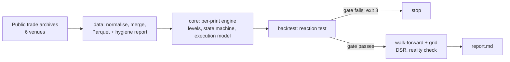

# wick-sweep-reclaim-backtester

[](https://github.com/nicolasMazuryk/wick-sweep-reclaim-backtester/actions/workflows/ci.yml)
[](LICENSE)

Deterministic, trade-stream-only backtesting monorepo that tests a stop-run reversal hypothesis with pre-registered gates, walk-forward validation and CI-enforced architecture.

## The problem

A common chart pattern says price returns to a wick extreme and reacts. Mechanically the trade is a *sweep-and-reclaim*: a fast extreme is swept by a shallow excursion, price crosses back through it, and the move is supposed to continue. With a 1x stop and a 2x target, a driftless path hits the target first one time in three, so a hit rate says nothing. The edge is `P(target first) − 1/3` after costs.

This repo is the machinery to find out whether that edge exists, and where it fails. It is built to disprove the idea honestly, not to make it look tradable. See [specs/strategy.md](specs/strategy.md).

## How it works



The reaction test runs first. `backtest` and `grid` refuse to run without a passing stored `reaction.json` ([ADR 0004](docs/adr/0004-reaction-gate-before-pnl.md)).

**Result of the study:** the research stopped after Phase 2 with verdict (a), no level effect. The decision log is in [specs/research-plan.md](specs/research-plan.md). The tooling is complete and tested; the strategy is not validated.

## Stack

TypeScript (strict, NodeNext), Node 22+, pnpm workspaces, Vitest and fast-check (property tests), ESLint with a custom plugin, Parquet (`parquet-wasm`), Terraform for Oracle Cloud.

## Getting started

```bash
pnpm install --frozen-lockfile
pnpm build
pnpm lint
pnpm test                # about 70 s, includes the byte-identical e2e reruns
node packages/cli/dist/main.js backtest --synthetic driftless --trades 20000 --seed 1
```

The last command replays a driftless random walk. The gate is expected to fail (`GATE FAIL (expected on a driftless walk)`), which shows the pipeline does not invent an edge from noise.

Other commands: `wsr data` (download and merge venue data), `wsr reaction`, `wsr backtest`, `wsr grid`, `wsr report`. Run `node packages/cli/dist/main.js --help`.

## Layout

```
packages/
  core/                @wsr/core    pure engine, no I/O
  data/                @wsr/data    venue adapters, Parquet storage
  backtest/            @wsr/backtest reaction test, walk-forward, grid, statistics
  cli/                 @wsr/cli     thin command layer
  eslint-plugin-wsr/   custom lint rules (no float prices, no venue literals)
configs/               default and pre-registered research configs
fixtures/              recorded venue samples and golden outputs
specs/                 strategy, implementation spec, research plan, hypothesis register
docs/                  determinism contract, ADRs
infra/oci/             Terraform for the research VM
research/, prompts/    research scripts and the agent prompts used on the VM
```

## Design decisions

- [0001 Trade-stream-only data model](docs/adr/0001-trade-stream-only.md)
- [0002 Integer ticks, enforced by a lint rule](docs/adr/0002-integer-ticks-and-lint-rule.md)
- [0003 Byte-identical determinism contract](docs/adr/0003-determinism-contract.md)
- [0004 Reaction gate before any P&L](docs/adr/0004-reaction-gate-before-pnl.md)
- [0005 pnpm monorepo, Parquet storage, OCI compute](docs/adr/0005-monorepo-parquet-oci.md)

Layer rules (`core` imports nothing, `data` imports `core`, and so on) are checked by ESLint and fail CI.

## Limitations

- Trades only: there is no order-book data, so fills are conservative bounds, not measured executions.
- Fee schedules and some venue details carry `[VERIFY]` notes in the specs.
- Gate's monthly archive lags, so its span ends before the other venues.
- No screenshot yet. TODO(me): add a sample `report.md` excerpt.

## License

[MIT](LICENSE)
